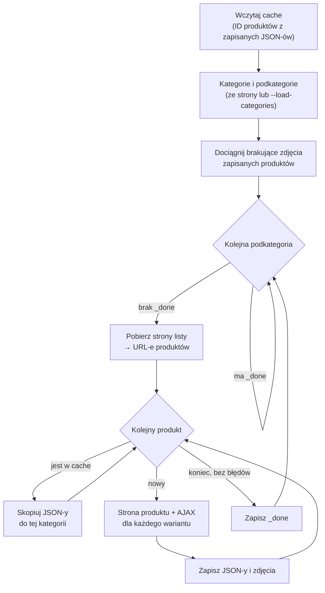

# Scraper — jak działa

Opis budowy i działania scrapera. Instrukcja uruchomienia: [Scraper_Instrukcja.md](Scraper_Instrukcja.md).

## Pliki

| Plik | Rola |
| --- | --- |
| `scraper/main.py` | Argumenty linii poleceń, uruchomienie scrapera. |
| `scraper/scraper.py` | Klasa `Scraper`: zapytania (limit, ponawianie), cache, przebieg po kategoriach, zapis JSON-ów i zdjęć. |
| `scraper/parser.py` | Czyste funkcje wyciągające dane z HTML i odpowiedzi AJAX. Bez sieci. |
| `scraper/models.py` | Typy kategorii (`Category`, `CategoryWithSubcategories`). |
| `scraper/tests/test_parser.py` | Testy parsera na plikach z `scraper/fixtures/`. |

Podział: `scraper.py` pobiera i zapisuje, `parser.py` tylko czyta tekst strony. Dzięki temu parser da się testować bez łączenia ze sklepem, a zmiana wyglądu strony źródłowej wymaga poprawek tylko w `parser.py`.

## Przebieg



### 1. Kategorie

Kategorie główne pochodzą z menu na stronie głównej. Dla każdej scraper pobiera jej stronę i wyciąga podkategorie (`#subcategories`). Kategoria bez podkategorii jest traktowana jak swoja jedyna podkategoria. Z `--category` filtrowanie następuje przed pobraniem podkategorii, więc pozostałe kategorie nie kosztują zapytań.

### 2. Lista produktów

Pierwsza strona podkategorii daje liczbę stron (paginacja) i pierwszą porcję URL-i. Kolejne strony pobierane są jako `?page=2`, `?page=3`… ID produktu pochodzi z URL-a (`/1026-wodka-crystal-head` → `1026`).

### 3. Dane produktu

Dane produktu nie pochodzą z HTML strony produktu, tylko z AJAX-a PrestaShopa:

1. Strona produktu → lista wariantów z selecta (`.product-variants select`).
2. Dla każdego wariantu (albo raz, gdy wariantów nie ma) zapytanie POST `index.php?controller=product` z `action=refresh`.
3. Z odpowiedzi brany jest atrybut `data-product` (JSON z nazwą, ceną, opisem, atrybutami i zdjęciami) i zapisywany jako `<id>_variant_<id_wariantu>.json` lub `<id>_no_variants.json`. Do tego JSON-a dopisywane jest pole `lowest_price_30d` (najniższa cena z 30 dni) z bloku cen `product_prices` tej samej odpowiedzi.

### 4. Zdjęcia

Dla każdego zdjęcia z `images` pobierany jest rozmiar `large_default` do `product_photos/<id_produktu>/<id_image>.<rozszerzenie>`.

- Sklep źródłowy zwraca WebP pod adresami `.jpg` i z nagłówkiem `image/jpeg`, więc format jest rozpoznawany po pierwszych bajtach pliku (sygnatura), a nie po adresie.
- Plik zapisuje się najpierw jako `.part` i dopiero po pobraniu dostaje docelową nazwę — przerwanie nie zostawi uszkodzonego zdjęcia.
- Istniejące zdjęcia są pomijane. Przy starcie scraper sprawdza wszystkie zapisane produkty i dociąga brakujące zdjęcia.

## Limit zapytań i ponawianie

Wszystkie zapytania przechodzą przez `Scraper.request()`:

- **Limit:** między początkami kolejnych zapytań mija co najmniej 0,5 s (maks. 2 zapytania/s). Scraper czeka tylko tyle, ile brakuje — czas parsowania i zapisu wlicza się w przerwę.
- **Ponawianie:** timeout, zerwane połączenie i statusy 429/500/502/503/504 są ponawiane do 3 razy, z przerwami 2, 4 i 8 s. Ponowienia też podlegają limitowi.
- **robots.txt:** przy tworzeniu `Scraper` pobierany jest `robots.txt` sklepu (parser `protego`, obsługuje wzorce `*` i `$`). Każdy adres — razem z parametrami zapytania — jest sprawdzany przed wysłaniem. Zablokowany adres rzuca `RobotsDisallowed`:
  - przy produkcie (strona, AJAX, zdjęcia) — produkt jest pomijany z komunikatem, ale **nie** liczy się jako błąd, więc podkategoria dostaje `_done` (inaczej byłaby ponawiana w nieskończoność);
  - przy kategoriach i listach produktów — scraper się zatrzymuje, jak przy innych błędach na tym poziomie.

  Scraper przedstawia się jako `User-Agent: EbizScraper/1.0` i ta nazwa jest dopasowywana do sekcji `User-agent` w robots.txt (sklep ma tylko `*`). Brak `robots.txt` (status 4xx) = wszystko dozwolone; błąd serwera (5xx) przerywa start scrapera.

## Cache i wznawianie

Stan scrapera to wyłącznie pliki na dysku — nie ma osobnej bazy.

- **Cache produktów:** na starcie `load_cache()` zbiera ID produktów z nazw plików JSON i zapamiętuje folder, w którym leżą. Produkt z cache nie jest pobierany ponownie.
- **Produkt w kilku kategoriach:** przy kolejnym wystąpieniu jego JSON-y są kopiowane z zapamiętanego folderu. Położenie plików w folderach to informacja o przypisaniu do kategorii.
- **`_done`:** znacznik w folderze podkategorii, zapisywany, gdy wszystkie jej produkty przeszły bez błędu. Podkategorie z `_done` są pomijane bez żadnego zapytania. Błąd choć jednego produktu = brak `_done` = podkategoria zostanie powtórzona.
- **`--clean`** usuwa `products/` i `product_photos/`, a z nimi cały stan.

## Logi

Scraper loguje modułem `logging` (logger `scraper`, konfiguracja w `main.py`) na konsolę i do pliku `scraper_results/scraper.log`. Plik jest dopisywany, więc przy wznawianiu zostaje historia poprzednich uruchomień.

```
2026-11-09 14:03:12.512 | 00:12:45 | INFO    | GET https://luksusowealkohole.pl/whisky?page=2
2026-11-09 14:03:13.013 | 00:12:46 | INFO    | POST https://luksusowealkohole.pl/index.php?controller=product&id_product=1026&id_customization=0
2026-11-09 14:03:13.120 | 00:12:46 | WARNING | Skipping https://...: Blocked by robots.txt: https://...
```

Kolejno: data i godzina z milisekundami, czas od uruchomienia (`hh:mm:ss`), poziom, treść.

- **Każde zapytanie** (także AJAX, zdjęcia, ponowienia i pobranie `robots.txt`) ma własną linię `GET`/`POST` z pełnym adresem. Odstępy między nimi (≥0,5 s) pokazują w logu, że limit 2 zapytań/s jest zachowany.
- `WARNING` — ponowienia i adresy pominięte przez robots.txt; `ERROR` — produkty, które się nie udały.

## Obsługa błędów

- Błąd pojedynczego produktu (sieć, nietypowa strona, brak danych) jest wypisywany i nie przerywa pracy (`except Exception` z `# noqa: BLE001` — celowo).
- Błąd przy pobieraniu kategorii lub listy produktów przerywa scraper — to oznacza poważniejszy problem. Ponowne uruchomienie wznawia pracę.
- Ctrl+C (`KeyboardInterrupt`) zawsze przerywa.

## Testy

Testy (`pytest`) sprawdzają funkcje z `parser.py` na stronach zapisanych ze sklepu źródłowego (`scraper/fixtures/`): kategorie, podkategorie, paginację, URL-e produktów, warianty, ID z URL-a oraz nazwę, cenę, opis i zdjęcia z odpowiedzi AJAX. Nie wysyłają zapytań, więc działają w CI.

Fixtures to pełne strony — mogą zawierać publiczne klucze (np. reCAPTCHA `data-sitekey`), dlatego `scraper/fixtures/` jest wyłączony ze skanu gitleaks w `.gitleaks.toml`. Nie zapisuj tam stron pobranych po zalogowaniu.

## Znane ograniczenia

- Ucięte nazwy podkategorii (`...`) — obejście przez `--save-categories` / `--load-categories` (zob. instrukcja).
- Nowe produkty w ukończonych podkategoriach (`_done`) nie zostaną pobrane bez usunięcia znacznika lub `--clean`.
- `listings.json` przy wznowieniu zawiera tylko podkategorie przechodzone w tym uruchomieniu.
- Folder z nazwą kończącą się kropkami (ucięte nazwy) na Windowsie straci kropki.
